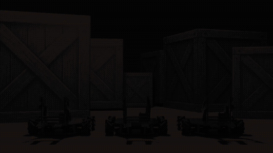

# Multi-Robot Formation Control for Cooperative Warehouse Transportation

Three small Mecanum-wheel robots that detect a box, form up around it, lift it together, and carry it to a goal, coordinated by an overhead camera and ROS 2.

Team project, German International University (GIU), Spring 2026. Authors are listed in the [IEEE-style paper](docs/IEEE%20Conference%20Paper.pdf).

## Demo

Overhead-camera view, sped up 6x. Click the preview for the full 72-second video.

## What it does

Instead of one large, expensive robot, several small robots share a load. The mission runs in five steps:

1. Detect the robots, the target box, and the goal
2. Move into the required formation around the box
3. Engage and lift the box
4. Move the formation toward the goal
5. Stop at the goal

The team built three Mecanum-wheel robots. The final demonstrator completed this full sequence with two of them carrying one box.

## System architecture

| Layer | What it does | Main tools |
|---|---|---|
| Perception | Overhead camera (720p, 30 FPS) detects boxes and robot poses in a calibrated global frame | YOLOv8n-OBB, ArUco markers, OpenCV |
| Communication | Sends velocity commands (vx, vy, ω) from the host PC to each robot over Wi-Fi | ROS 2, micro-ROS (UDP) |
| High-level control | Formation control, collision avoidance (repulsive term), and centroid tracking | ROS 2 nodes (vision, controller, scheduler) |
| Low-level control | Regulates wheel speed from encoder feedback | ESP32, BT7960 drivers, feedforward + PID |

## Results

- Full mission demonstrated with two robots: formation, lifting, and transport to the goal
- Perception pipeline sped up from roughly 100 ms to about 15 ms per frame with multithreading
- Wheel-speed control stabilised under real load by moving from L298N to BT7960 drivers and adding feedforward, gain scheduling, RPM filtering, ramping, and anti-windup
- Total cost 35,604 EGP, about 41% lower than the previous team's design

## My contribution

- Low-level closed-loop control for the four Mecanum-wheel DC motors on each of the three robots, using encoder feedback, including PID tuning for velocity tracking
- ArUco marker-based detection and localization, publishing robot poses to the ROS 2 formation-control framework

## Code

- [`firmware/motor_speed_tuning`](firmware/motor_speed_tuning): my ESP32 wheel-speed tuning firmware (feedforward + gain-scheduled PI, Mecanum kinematics, Serial test commands)

## Documentation

- [IEEE-style paper (5 pages)](docs/IEEE%20Conference%20Paper.pdf)
- [Final report](docs/Final%20Report.pdf)
- [Presentation](docs/presentation.pdf)

## Limitations and future work

The system depends on overhead-camera visibility, accuracy drops near the workspace edges because of parallax, and performance varies with floor friction, load, and Wi-Fi quality. Next steps: centroid tracking for three robots, broader obstacle avoidance, and testing with heavier loads.
